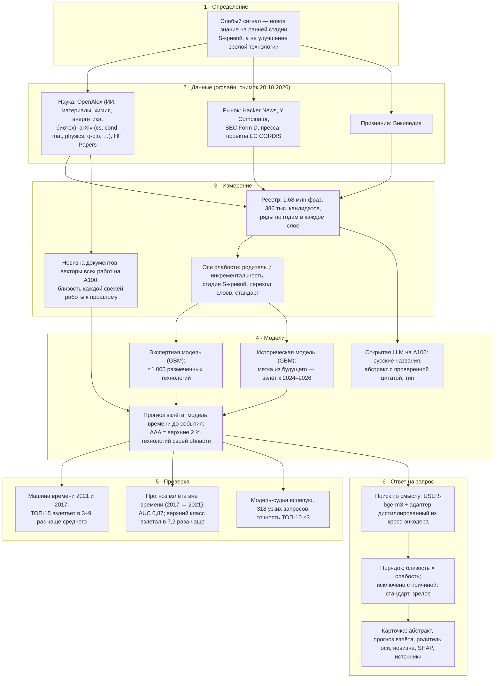

<p align="center">
  
</p>
<p align="center">
  <b>Задача Газпромбанк.Тех</b> · «Лидеры цифровой трансформации 2026» ·
  <a href="https://signal-radar.ru">signal-radar.ru</a> ·
  <a href="#запуск-за-две-команды">запуск за две команды</a>
</p>
<p align="center">
  
</p>

> **Слабый сигнал — это вывод в условиях неопределённости. Поэтому Предвестник не просит верить машине на слово.**
>
> У каждого вывода видна его база: источники с датой и дословной цитатой, данные по годам в науке, у разработчиков,
> стартапов и прессы, вклад каждого признака в балл. Эксперт может проверить, почему система пришла к такому
> выводу, — и решает сам, а не следует за моделью вслепую.

## Не просто LLM-обёртка

Предвестник — полноценная исследовательская система: тяжёлые вычисления сделаны заранее, а каждый вывод можно
проверить.

| Наше решение | Что в нём сильного |
|---|---|
| **9,96 млн научных работ** | Анализируем не подборку популярных новостей, а большой междисциплинарный корпус: ИИ, материалы, химия, энергетика, физика и биотех. |
| **Расчёты на NVIDIA A100** | Заранее посчитали векторы миллионов документов, новизну каждой свежей работы, русские карточки и разметку учителя. |
| **Новизна относительно всего прошлого** | Для 2,4 млн свежих работ нашли ближайшего предшественника — модель отличает новое знание от очередной вариации известного. |
| **Кросс-энкодер без его задержки** | Прогнали BAAI/bge-reranker-v2-m3 на A100 и дистиллировали его знания в low-rank-адаптер запроса; в продакшене это одно умножение матрицы. |
| **Открытая Qwen2.5-14B** | Офлайн создала русские названия и объяснения, а затем вслепую оценила 3 180 результатов по 318 запросам. |
| **Машина времени** | Модель получает только данные до 2017 или 2021 года, а затем проверяется по тому, что действительно взлетело позже. |
| **Две объяснимые модели** | Экспертная учится на человеческой разметке, историческая — на фактах из будущего; обе объясняются через SHAP. |
| **Рейтинг потенциала взлёта** | Понятная шкала от AAA — верхних 2 % технологий своей области — до CCC, самого низкого класса; горизонт прогноза — пять лет. |
| **Оси слабости** | Измеряем зрелого родителя, инкрементальность, стадию S-кривой, переход наука → рынок и признаки стандарта. |
| **Неудачные гипотезы не скрыты** | Мигранты между областями, линейная модель путей и несколько красивых индексов были проверены и исключены. |
| **9 437 технологий в базе v6** | Карточки, векторы, оси, модели и адаптер уже лежат в репозитории; исходный корпус для ответа не нужен. |
| **CPU в продакшене, GPU только офлайн** | После тяжёлой подготовки на A100 сервис работает без видеокарты и отвечает из базы за 1–2 секунды. |

> **Мы использовали A100 не для эффектной генерации текста.**
>
> На GPU выполнены вычисления, которые нельзя позволить себе во время пользовательского запроса: сравнение
> миллионов научных работ с прошлым, обучение учителя-кросс-энкодера и офлайн-разметка базы. Затем результат сжат
> в быстрый CPU-сервис.

## Каждый сигнал — с объяснением

Мы не выдаём голый список. Про каждую технологию карточка отвечает на пять вопросов — по источникам и данным,
а не по мнению языковой модели:

| Вопрос | Чем отвечаем |
|---|---|
| **Что появилось?** | конкретное изменение в технологии — по источникам карточки |
| **Почему сейчас?** | датированное событие с дословной цитатой источника и рост в данных |
| **Почему это ещё ранняя стадия?** | где найден сигнал (наука → сообщество → стартапы → пресса → энциклопедия) и чего пока не знаем |
| **Зачем бизнесу?** | какую проблему решает — отдельно от доказанного результата |
| **Почему такой балл?** | вклад каждого признака в балл ранжирования (SHAP) и похожая динамика в прошлом |

<p align="center">
  
</p>

### Почему такой балл: SHAP

Каждый балл ранжирования разложен на вклады признаков: от средней технологии каждый признак сдвигает балл вверх
(зелёный) или вниз (красный), последняя строка — итог. Так видно, из чего сложилась оценка: рост доли в науке,
обсуждения разработчиков, свежесть темы, охват научных областей. Вторая модель — историческая — показывает свой
разбор отдельно.

<p align="center">
  
</p>

**Главная идея.** Мы не спрашиваем у языковой модели, что сейчас в тренде. Заранее, по офлайн-корпусу из
9,96 млн научных работ и рыночных источников, мы собираем **базу слабых сигналов**: для каждой технологии измеряем,
как она ведёт себя в открытых источниках (рост в науке, выход в стартапы, прессу, проекты ЕС, нет ли уже
энциклопедической статьи), оцениваем двумя объяснимыми моделями, присваиваем **прогноз взлёта** — шанс стать
массовой за пять лет, проверенный на прошлом, — и вычищаем всё, что эксперт не признал бы слабым сигналом. Ответ на
запрос — поиск по смыслу в этой базе за 1–2 секунды; YandexGPT, если подключён, только проверяет кандидатов по
источникам.

**Слабый сигнал — новое знание на ранней стадии S-кривой, а не улучшение зрелой технологии.** Поэтому поверх роста
и массы считаются **оси слабости** (`registry/axes.py`): родитель и инкрементальность («adaptive mixed precision
quantization» ← «quantization»: улучшение известного, балл снижен), ускорение и положение на S-кривой, переход
слоёв наука → сообщество → рынок, признак стандарта или протокола, новизна текста работ относительно всего, что
писали раньше. Стандарты, зрелое и улучшения известного уходят в блок «исключено» с причиной. Как это проверено
числами — `docs/EVAL.md`; почему именно так — `docs/WHY_IT_WORKS.md`.

## Логика решения



Каждое звено можно проверить отдельно: определение задаёт, что измеряем; данные — только открытые и датированные;
модели объяснимы (SHAP); проверка на прошлом объективна (метка из будущего, без чьей-либо разметки); языковая модель
не решает, что является сигналом: она пишет названия и абстракты, а цитата сверяется с источником программно.

## Смелые решения, которые мы проверили числами

- **Посчитали новизну, а не спросили о ней LLM.** На A100 построены векторы всего научного корпуса. Для каждой из
  2,4 млн свежих работ система ищет ближайшую работу из прошлого и измеряет, действительно ли появилось новое
  знание (`gpu/`, `registry/doc_novelty.py`).
- **Дистиллировали дорогой поиск в одну матрицу.** Полный кросс-энкодер слишком медленный для CPU-продакшена.
  Поэтому он разметил на A100 5 720 запросов × 50 кандидатов, а его порядок был перенесён в low-rank-адаптер
  вектора запроса. На отложенных запросах выигрыш есть по всем метрикам, а ответ занимает 1–2 секунды
  (`scripts/distill_adapter.py`, `docs/EVAL.md` §4в).
- **Превратили прогноз в понятный класс потенциала.** Модель оценивает, насколько вероятно, что технология станет
  массовой в ближайшие пять лет, и сравнивает её только с технологиями той же области: например, новый материал —
  с другими материалами, а не с ИИ. **AAA означает верхние 2 % своей области, CCC — нижние 30 %.** Это относительный
  класс, а не обещание и не банковский рейтинг. В проверке вне времени — обучение на данных 2017 года, рейтинг на
  2021 год и фактический исход к 2026 году — AUC составил 0,87, а технологии класса AAA взлетали в 7,2 раза чаще
  среднего по своей области (`registry/rating.py`, `docs/EVAL.md` §6).
- **Заставили модель предсказывать прошлое.** Машина времени по обработке языка: из 15 технологий, выбранных по
  данным 2021 года, к 2024–2026 выросли 8 — против одной из шестнадцати в среднем (в 8,7 раза чаще), массовыми они становились в среднем
  через 3,2 года после того, как система их выделила. На данных 2017 года — 33 % против 11,9 %.
- **Отделили новое знание от улучшения известного.** Система ищет зрелого родителя технологии, измеряет положение
  на S-кривой и переход между слоями. «Adaptive mixed precision quantization» получает штраф как улучшение зрелой
  `quantization`; стандарты и протоколы уходят в блок «исключено» с причиной (`registry/axes.py`).
- **Оставили человеку право не согласиться.** Каждый балл разложен через SHAP, каждый источник датирован, цитаты
  проверяются программно, а исключённые результаты остаются видимыми с причиной. Экспертная модель обучена на
  разметке «сигнал или нет», историческая — на том, что реально взлетело.
- **Независимая проверка вслепую.** Модель-судья (Qwen2.5-14B) оценила 3 180 позиций выдачи на 318 узких запросах
  из материалов, энергетики, инженерии, финтеха и биотеха, не зная версии: точность ТОП-10 выросла втрое
  (5,5 % → 16,6 %), «по теме» — с 15 % до 43 % (`scripts/judge_eval.py`, `docs/EVAL.md` §4а).
- **Вся наука, а не только ИИ.** 9,96 млн научных работ: OpenAlex по ИИ, материалам, химии, энергетике, биотеху и
  инженерии, arXiv cs, cond-mat, physics, q-bio, quant-ph; на запрос «многослойный графен» отвечают ромбоэдрический и
  скрученный многослойный графен, на «водородные хранилища» — материалы для хранения водорода.
- **Открытые модели вместо внешнего API.** Русские названия (80 % записей), описания и абстракт «почему в выдаче» с
  дословной цитатой, проверенной программно (8 438 записей), — Qwen2.5 на A100, один раз при обновлении
  (`registry/llm_offline.py`). YandexGPT подключается ключом без изменения кода.
- **Исключено с причиной.** Ultra Ethernet, UCIe, A2A — отраслевые стандарты; зрелое по году и по экспертной
  проверке — в отдельном блоке витрины, как требует ТЗ.
- **Где найден сигнал — измерено.** Наука → сообщество → стартапы → пресса → энциклопедия; участники исследований из
  OpenAlex, стартапы YC, раунды SEC Form D.

## Запуск за две команды

```bash
git clone https://github.com/weak-signals-forecast/predvestnik.git && cd predvestnik
docker compose up -d db registry     # витрина: http://localhost:8010, API и документация: http://localhost:8010/docs
```

По умолчанию контейнер поднимает базу v6 (`artifacts/registry_v6`: 9 437 технологий, векторы, карточки, оси,
прогноз взлёта, новизна, адаптер запроса) с порядком и фильтрами версии 2. Ключ YandexGPT необязателен: положите
`YANDEX_API_KEY` и `YANDEX_FOLDER_ID` в `.env` (шаблон — `.env.example`), и сервис начнёт проверять кандидатов по
источникам. Переключатели в окружении: `REGISTRY_BUNDLE=/app/artifacts/registry REGISTRY_RANK_V2=0` — прежняя база и
порядок (откат), `REGISTRY_ADAPTER=0` — без адаптера запроса, `REGISTRY_RERANK=1` — кросс-энкодер прямо в ответе
(для сервера с видеокартой). Без Docker: `pip install -r requirements-registry.txt` и `make registry-serve`.

Компактная база v5d (4 118 технологий) остаётся в репозитории. Запуск с ней:

```bash
REGISTRY_BUNDLE=/app/artifacts/registry_v5d REGISTRY_CACHE=/cache/v5d docker compose up -d --build db registry
```

```bash
curl -s -X POST localhost:8010/api/registry/search -H 'Content-Type: application/json' \
     -d '{"query": "многослойный графен"}'
curl -s localhost:8010/api/registry/health
```

Корпус для ответа не нужен: всё, что нужно сервису, лежит в репозитории. Образ `registry` — Python, torch для
процессора и векторная модель USER-bge-m3; сервис работает без видеокарты и занимает около 1–2 ГБ памяти. Ответ из
базы — 1–2 секунды; с проверкой YandexGPT Pro — до минуты. Подготовка данных идёт отдельно и заранее: сборка реестра
и моделей на обычном сервере — несколько часов, расчёты на A100 (`gpu/`) — несколько часов один раз при обновлении.

## Карточка сигнала

Карточка отвечает на вопрос пользователя «что появилось и почему мне стоит обратить внимание?» и разводит три вещи:
**технологию** (заголовок), **сигнал** (конкретное датированное событие внутри направления) и **прогноз** (что это
может изменить — предположение). Источники подтверждают событие, модель оценивает его значимость, прогноз остаётся
предположением.

1. **Что за сигнал** — конкретное технологическое изменение, двумя предложениями.
2. **Почему сейчас** — событие, подтверждённое дословной цитатой источника с датой, и рост в данных.
3. **Почему ранняя стадия** — что уже подтверждено, где найден сигнал (слои корпуса), чего пока не знаем.
4. **Зачем бизнесу** — какую проблему решает; предполагаемая польза отдельно от доказанного результата.
5. **Кто уже пробует** — участники исследований и разработок: компании, университеты, лаборатории с двумя и более
   работами по теме, стартапы YC (аффилиация авторов — участие в исследованиях, а не доказательство внедрения).
6. **Доказательства** — два-три ключевых источника с пояснением, что каждый подтверждает.
7. **Подробнее** — факты из данных, «где найден сигнал», ряды по годам, балл ранжирования и его разбор SHAP,
   все участники, «похожая динамика в прошлом» (тема 2021 года с похожей траекторией; сходство кривых не доказывает
   сходство будущего), все источники с названием, ссылкой, датой, типом, языком и уровнем доверия.

В свёрнутой строке — название, одно конкретное изменение, где найден сигнал и балл ранжирования (0–100, место среди
записей базы, не вероятность). Под ТОП-15 — ещё сигналы по теме, проверенные YandexGPT, и кандидаты из базы.

## Модели и проверка

- **Экспертная модель** — градиентный бустинг на ≈1 000 технологиях, размеченных по критерию слабого сигнала.
  **Историческая** — тот же бустинг на истории: признаки на конец 2021 года, метка из будущего — взлетела ли тема к
  2024–2026 (без чьей-либо разметки). Итоговый балл — 70 % экспертной и 30 % исторической; обе объяснены через SHAP.
- **Прогноз взлёта** — дискретная модель времени до события на срезах 2017 и 2021. Она присваивает относительный
  класс внутри области: AAA — верхние 2 % технологий по потенциалу взлёта, CCC — нижние 30 %.
- **Проверка:** машина времени (`python -m registry.time_machine_topic`), прогноз взлёта вне времени
  (`python -m registry.rating validate`), модель-судья (`scripts/judge_eval.py`), поиск записи по заголовку её работы
  без разметки (`scripts/eval_retrieval.py`). Все цифры и протоколы — `docs/EVAL.md`.
- **Модели:** USER-bge-m3 (поиск по смыслу, локально), BAAI/bge-base-en-v1.5 (векторы документов),
  Qwen2.5-7B/14B-Instruct (названия, абстракты, оценка выдачи), BAAI/bge-reranker-v2-m3 (учитель адаптера) —
  локальные модели с Hugging Face; YandexGPT Lite и Pro (по ключу); градиентный бустинг (scikit-learn).

## Этап 1: модель на размеченном датасете

Кросс-валидация 5 × 10: accuracy 86 %, precision 74 %, recall 87 %, F1 80 %. 

## PostgreSQL

При старте база и связи «кто стоит за сигналом» загружаются в `registry_signals` и `registry_actors`, каждый запрос
с ответом пишется в `registry_runs`.

## Наши собственные идеи

- **Прогноз взлёта.** Модель времени до события оценивает потенциал технологии стать массовой за пять лет. Класс
  AAA означает верхние 2 % внутри своей области; на исторической проверке такие технологии взлетали в 7,2 раза
  чаще среднего. Обучение — данные 2017 года, рейтинг — 2021 год, фактический исход — 2026 год; AUC 0,87.
- **Реестр прогнозов.** Прогноз фиксируется с датой и критерием успеха; `python -m wsignals.takeoff score` через три
  года проверит, сбылся ли он. Прогноз можно опровергнуть.
- **Машина времени.** Признаки на конец 2021 года — только по данным до этой даты. Будущий мейнстрим модель отмечала
  как слабый сигнал в 25 % случаев, зрелое — в 4 % (p = 0,003): различает стадию, а не запоминает названия.
  Отчёт: `reports/timemachine.md`.
- **Исторический двойник.** Технология 2021 года с самым похожим набором признаков и то, чем она стала: «похожа на
  векторные базы данных в 2021 году — они стали мейнстримом». Только при полном векторе признаков.
- **Лестница зрелости.** Наука, код, сообщество разработчиков, медиа, энциклопедия: у слабых сигналов в среднем
  1,4 ступени, у зрелых — 4,1.
- **Тест на утечку из будущего.** Данные после даты среза заменяются мусором — признаки не должны измениться. Тест
  нашёл две настоящие ошибки, обе исправлены.

## Где что лежит

```
registry/                сборка базы: реестр фраз (build, score), бизнес-слой, оси (axes), модели (expert_model,
                         history_model), прогноз взлёта (rating), новизна документов (doc_novelty), открытая модель
                         (llm_offline), сборка набора (mini_bundle, bundle)
registry_service/        сервис базы: FastAPI (main), поиск и ответ (service), порядок и фильтры v2 (rank),
                         кросс-энкодер (rerank), PostgreSQL
gpu/                     расчёты на A100: векторы документов, новизна, открытая LLM, учитель для адаптера
web/                     витрина (открывается из сервиса registry)
artifacts/registry_v6/   база по умолчанию: 9 437 технологий, векторы, карточки, оси, прогноз взлёта, новизна, адаптер, кэш LLM
artifacts/registry_v5d/  компактная база: 4 118 технологий
artifacts/registry/      прежняя база (откат)
scripts/                 проверки: judge_eval (модель-судья), eval_retrieval (поиск без разметки),
                         distill_adapter (адаптер запроса), make_ru_queries, eval_queries
wsignals/, api/, ui/     живой путь по открытым API и модель этапа 1; в ответе сервиса базы не используется
data/labels/             разметка: экспертная проверка базы, отрицательные примеры
docs/                    METHODOLOGY (конвейер), WHY_IT_WORKS (обоснование), EVAL (цифры), architecture.puml (схема)
tests/                   1 045 юнит-тестов без сети и корпуса
legacy/                  исследовательский прототип первой версии; в сервисе не используется
```

Воспроизводимость сборки: корпус (`GPB_CORPUS`) и реестр (`GPB_REGISTRY`) задаются переменными окружения и лежат вне
репозитория; разметка экспертной модели и обученные модели — в папке реестра. Конвейер: `registry.build all` →
`registry.score` → `registry.axes` → `registry.apply_models` → `registry.mini_bundle --quota …` → `registry.rating
apply` → `gpu/` → `registry.doc_novelty` → `registry.llm_offline import`.
